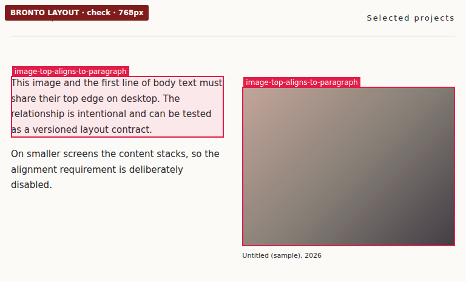

# Bronto Layout

[](https://github.com/Ponchia/bronto-layout/actions/workflows/ci.yml)
[](LICENSE)

**Check layout relationships, not just pixel differences.**

Bronto Layout is a framework-independent, local CLI and TypeScript library for responsive layout verification. Inspect a site without writing a test, then explicitly preserve the alignments, spacing and containment rules that matter to your design. Reports work in terminals, CI and coding-agent workflows.

**Status:** MIT-licensed, experimental **[v0.5.0-beta.1 GitHub prerelease](https://github.com/Ponchia/bronto-layout/releases/tag/v0.5.0-beta.1)**. The published beta.1 tarball includes fail-closed CSP-sandbox diagnostics (beta.0 did not). The GitHub tarball is available; **the package is not published to the npm registry**. Chrome/Chromium and Node.js 22+ are needed for browser checks. Auto-detection prefers installed stable Chrome on Linux; use `--chrome PATH` or `CHROME_PATH` to override. The CLI ships no browser or third-party runtime dependencies and needs no account or hosted service.

The source tree is preparing `0.5.0-beta.2`; the release link above remains the
last published GitHub archive until a new release is verified. Current beta
qualification uses [in-house checks](docs/in-house-validation.md), not outside
developer recruitment. Registry publication is a separate authenticated step.

## See it catch an actual layout relationship regression

This local, self-contained example intentionally moves a portfolio image 18px below the first paragraph at desktop widths. Both pages can appear superficially healthy to a zero-config audit; only an **approved alignment contract** knows this is wrong.

```sh
git clone https://github.com/Ponchia/bronto-layout.git
cd bronto-layout
npm ci
npm run build

# Test your Chromium installation before navigating anywhere:
node bin/bronto-layout.mjs doctor --verify-launch

# Healthy portfolio layout: should exit 0.
node bin/bronto-layout.mjs check --spec examples/portfolio-alignment.json

# Same page with intentional misalignment: should exit 1.
node bin/bronto-layout.mjs check --spec examples/portfolio-alignment.json \
  --url examples/portfolio-alignment-broken.html
```

The included contract checks 375, 768 and 1280 CSS-pixel viewports. The alignment applies only at desktop/tablet widths; mobile deliberately stacks its content. See [the complete walkthrough](docs/portfolio-regression-case-study.md).



*Real CLI screenshot, cropped from the self-contained intentionally broken 768px fixture—not a production-site finding or an accuracy claim.*

## Try your own site

```sh
# No contract: measured overflow and visible broken images; other leads need review.
node bin/bronto-layout.mjs audit --url http://localhost:5173 \
  --widths 320,375,768,1280 --json --compact

# Create a versioned contract skeleton, then edit selectors and rules.
node bin/bronto-layout.mjs init --url http://localhost:5173 \
  --out bronto-layout.json
node bin/bronto-layout.mjs validate --spec bronto-layout.json
node bin/bronto-layout.mjs check --spec bronto-layout.json --json

# Optional: suggest relationships and approve only the ones you intend to keep.
node bin/bronto-layout.mjs suggest --url http://localhost:5173 \
  --widths 375,768,1280 --out proposals.json
```

**Exit codes:** `0` = observed checks passed, `1` = measured violation/regression, `2` = invalid input, runtime failure or unverified evidence. A successful check **does not prove the entire visual design is correct**. A zero-contract audit cannot infer design intent.

The tool does **not** repair CSS automatically. The suggestion workflow produces reviewable drafts; it does not turn observed relationships into blocking assertions without your explicit approval.

## Run it inside an owned project or AI workflow

The [beta integration guide](docs/beta-integration.md) shows a verified GitHub-release package install, a source checkout, a reusable commit-pinned GitHub Action, a strict CI contract check, and a sample `AGENTS.md` instruction. **No npm package, analytics service or hosted dashboard is required for the Action.** The Action stores JSON locally and does not upload private evidence automatically. An external workflow must pin a reviewed commit SHA and bring its own running site.

Responsive checks can opt into `--interior-probes 3 --refine` to sample failures between passing endpoints; the report documents sampled and untested widths. This improves coverage without asserting correctness at widths that were never visited. A reusable batch manifest can also opt into `interiorProbes`, `refine` and `failOnSkip` per approved contract job.

## Why semantic contracts?

A screenshot comparison can tell you that pixels changed; it cannot tell you whether a particular relationship must stay fixed. Bronto Layout supports 14 constraint kinds, including edge alignment, containment, centering, equal/uniform gaps, element counts, non-overlap, dimensions, image proportion, clipping and observed layout stability. Rules can be scoped to viewport ranges and explicit UI states.

You can:
- Run conservative **zero-contract audits** and review potential layout leads separately from confirmed measurements.
- **Compare baseline and candidate revisions** using stable contract rules, JSON/SARIF reports and optional visual evidence.
- Test **multiple widths, breakpoints and routes**, including RTL, open Shadow DOM and declared interactions.
- Use optional **real browser pointer-click** checks when a DOM event alone would falsely “open” an obscured or offscreen control; separate mouse hit testing from keyboard/touch usability.
- **Inspect element geometry and matched CSS** without fabricating a source-level root cause.
- Use the **pure TypeScript evaluation engine** with host-provided geometry, without Chromium or a framework dependency.

**Limitations:** Browser execution currently supports Chromium-family browsers only. Closed shadow roots, cross-origin frame interiors, canvas/WebGL paint and unobserved application states are not verified. CSS-visible canvases are reported as known uninspected paint surfaces rather than clean rendered content. Heuristic text clipping/overlap/spacing findings are review warnings rather than automatic proof of a design error. Please don't use a sandbox override to visit untrusted websites.

## Validation status and releases

- Automated CI runs on Node 22/24 with Chromium, package-install smoke checks, a portable-core coverage threshold and maintained macOS hosted-runner checks.
- Controlled fixture benchmarks provide reproducible regression protection; **they are not an estimate of real-world precision/recall**.
- The original 30-state and expanded [42-state v0.2 cohort](https://github.com/Ponchia/bronto-layout/blob/main/benchmarks/field-sites.v0.2.json) have been captured. The expanded smoke caught a genuine 320px BrontoUI overflow, later fixed and [verified on the deployed site](https://github.com/Ponchia/bronto-layout/actions/runs/38353798145). **Independent field-review labels and accuracy estimates remain pending**.
- [GitHub beta distribution](https://github.com/Ponchia/bronto-layout/releases) provides checksum-verified `.tgz` packages for released versions; **no npm registry publication, general-availability claim, or real-world accuracy claim**. See the [release checklist](docs/release-checklist.md) and [field benchmark protocol](docs/field-benchmark.md).

## Documentation

Use the [documentation index](docs/README.md) for current guides and historical evidence.


| Start here | Details |
| --- | --- |
| [10-minute first-run guide](docs/quickstart.md) | Audit, suggest, approve, state replay and batch |
| [Beta integrations and agent recipe](docs/beta-integration.md) | Local/source installation, pinned GitHub Action, CI coverage and agent policies |
| [Existing Playwright test adapter](docs/playwright-adapter.md) | Reuse Playwright Page state, capture DOM geometry, evaluate approved contracts without launching another browser |
| [npm beta bootstrap and protected OIDC](docs/npm-publishing.md) | Authenticated first release, then provenance-attested, manually approved GitHub tag publishing |
| [First-party beta trial worksheet](docs/beta-trial-template.md) | Record controlled pilot evidence without publicly exposing user data |
| [First-party beta pilot findings](docs/first-party-beta-pilots.md) | Measured project integrations, controlled failures, security limits and remaining evidence gaps |
| [Weekly owned-site layout pulse](docs/first-party-pulse.md) | Six fixed public routes, sandboxed Chromium, sampled-width and coverage summary without uploading browser evidence |
| [Independent first-use trial](docs/first-use-trial.md) | Short, privacy-conscious feedback exercise for new developers |
| [Portfolio regression case study](docs/portfolio-regression-case-study.md) | A known, deliberately introduced defect with healthy/broken pages |
| [Real downstream CI: BrontoUI](docs/real-consumer-brontoui.md) | A pinned consumer workflow with passing contracts and a caught regression |
| [CLI reference](docs/cli-reference.md) | Extended commands, scenarios, screenshots and examples |
| [Architecture](docs/architecture.md) | Core, browser adapters, CDP process lifecycle, evidence and coverage |
| [Contract discovery](docs/contract-discovery.md) | Why suggestions require human approval |
| [Benchmarks](docs/audit-benchmark.md) and [field validation](docs/field-benchmark.md) | Controlled fixtures versus independently labeled sites |
| [External open-source website study](docs/oss-field-study.md) | Separate OSS cohort, limitations and independent-review protocol |
| [External mobile-navigation states](docs/oss-mobile-state-study.md) | Fixed anonymous menu-opening experiments, post-click assertions and screenshots |
| [External below-the-fold states](docs/oss-scroll-state-study.md) | Fixed Vite/Docusaurus section targets, actual scroll offsets and bounded screenshot evidence |
| [Pinned source-built Eleventy study](docs/oss-source-built-study.md) | Independent project build, responsive contracts, controlled semantic fault |
| [Historical Svelte flex regression](docs/oss-historical-flex-regression.md) | Source-inspired switch occlusion caught by existing vertical containment contracts |
| [Contributing](CONTRIBUTING.md) and [security](SECURITY.md) | Local tests, reporting issues and safety |

## Contribute

See [CONTRIBUTING.md](CONTRIBUTING.md). Bug reports that include a minimal reproduction, CSS width and expected layout relationship are especially valuable. The repo is MIT-licensed; no telemetry, SaaS account or hosted dashboard is required.

If the tool saves you time, you can [support its maintenance on Ko-fi](https://ko-fi.com/ponchia). Donations are optional; no functionality, accounts or updates are gated by payment.
