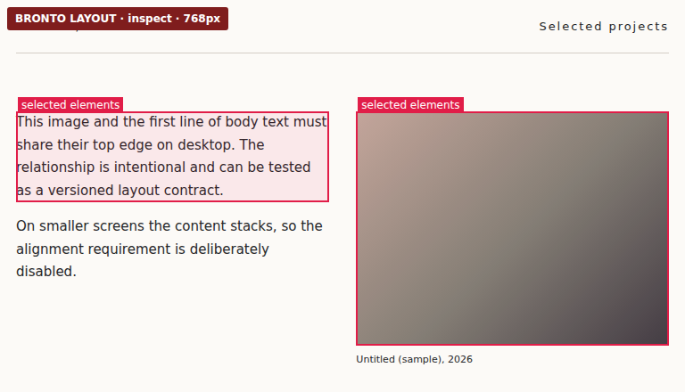
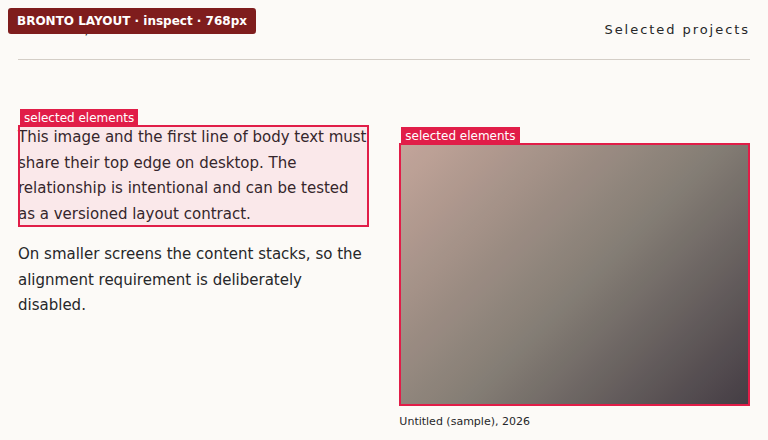

# Bronto Layout: first useful check

Lifecycle: current

Bronto Layout checks explicit relationships in a page: for example, whether an
image stays aligned with its text. Node.js 22+ and an installed Chrome or
Chromium are required for browser checks. The tool does not need a hosted
account, a component framework, or a bundled browser.

## Start with the published npm beta

You need a local Node.js 22+ project and Chrome/Chromium installed. Use the
published package; a source checkout and build are not required for first use.

```sh
mkdir bronto-layout-first-run
cd bronto-layout-first-run
npm init -y
npm install --save-dev @ponchia/layout@0.5.0-beta.2
npx --no-install bronto-layout doctor --verify-launch --json
```

A successful preflight returns `launch-verified`. Finding a Chrome executable
alone does not establish startup. Use `--chrome /path/to/chrome` if choosing a
different installed browser. Do not disable sandboxing to inspect public or
authenticated pages.

This guide pins the qualified `0.5.0-beta.2` example. Use `@beta` instead when
you intend to follow the registry's current beta tag. The source checkout can
be ahead of the published package.

If preflight fails, install Chrome/Chromium or select its executable with
`--chrome /path/to/chrome` or `CHROME_PATH`. Read the reported launch error and
resolve local permissions or sandbox support, then retry `doctor`. Exit 2 is
an environment/input failure, not a layout verdict. Do not continue on the
assumption that browser discovery proves a healthy launch.

The installed package includes the complete example contract and its healthy
and broken HTML fixtures. The commands below only read those trusted examples
from the npm package; they do not install extra browser automation tools.

If you are changing Bronto Layout itself, use the
[contributor instructions](../CONTRIBUTING.md) for the separate source
checkout and build workflow.

## Observe a passing rule and a deliberate failure

```sh
npx --no-install bronto-layout check \
  --spec node_modules/@ponchia/layout/examples/portfolio-alignment.json \
  --url node_modules/@ponchia/layout/examples/portfolio-alignment-healthy.html

# The next command deliberately fails (exit code 1).
npx --no-install bronto-layout check \
  --spec node_modules/@ponchia/layout/examples/portfolio-alignment.json \
  --url node_modules/@ponchia/layout/examples/portfolio-alignment-broken.html
```

The first command exits 0. The second exits 1: its image is intentionally
18 pixels lower than its text at the desktop/tablet widths. The contract
allows the stacked mobile layout. This is a controlled example, not a claim
about the accuracy of a general visual detector.

| Fixture | Expected output | Exit |
| --- | --- | --- |
| Healthy | 11 passed, 0 failed, 1 skipped | 0 |
| Broken | 9 passed, 2 failed, 1 skipped | 1 |

The skipped rule is desktop alignment at 375px. The two broken findings name
`image-top-aligns-to-paragraph` at 768 and 1280px: 18px exceeds the approved
2px tolerance. [Healthy output](assets/first-use/healthy.txt),
[broken output](assets/first-use/broken.txt), and
[capture metadata](assets/first-use/evidence.json) come from the installed npm
beta.2, not a source build.





These are unmodified `inspect` screenshots. Red boxes identify selected
elements in both states; the `check` output determines pass or failure.
Capture used the documented fixture-only sandbox override on a restricted
test host after normal startup failed. This does not qualify sandboxed browser
startup on that host; your first-use commands keep the sandbox enabled.

## Inspect your own local page

Start your application's usual development server, then run:

```sh
npx --no-install bronto-layout audit --url http://localhost:5173 \
  --widths 320,375,768,1280 --json --compact
```

Measured overflow and failed visible images differ from review-only leads
and unavailable surfaces. A clean audit does not establish that your visual
design is correct. Define the relationships you intend to preserve:

```sh
npx --no-install bronto-layout init --url http://localhost:5173 \
  --out bronto-layout.json
npx --no-install bronto-layout validate --spec bronto-layout.json --json
```

Edit the generated selectors and rules before enforcing them. Suggestions
are drafts, never automatically approved constraints. Then run `check --spec`
on the reviewed contract. Use a separate `--report` path so input files and
local pages remain unchanged.

## Interpret the result

| Exit | Meaning |
| --- | --- |
| 0 | Observed checks passed or no verified regression was found. |
| 1 | A measured violation or regression was found. |
| 2 | Invalid input, runtime failure, or unverified evidence. |

A comparison with no applicable rules exits 2. Two missing measurements are
unverified, not unchanged. Mutating `click`, `fill`, and `scroll-into-view`
actions require exactly one matching target; `wait-for` only checks existence.
Closed shadow roots, canvas paint, cross-origin frame contents, and untested
states remain outside the verified scope.

Continue with [integration recipes](beta-integration.md), the
[Playwright adapter](playwright-adapter.md), or [extended CLI recipes](recipes.md)
for schemas, state replay, screenshots, responsive sampling, and batch checks.
The [in-house acceptance matrix](in-house-validation.md) describes how releases
are tested without assigning work to external developers.
